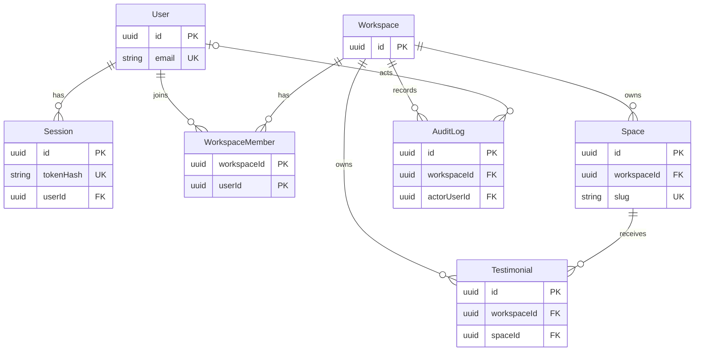

# Data model

Derived from the Prisma schema and the single migration. Every statement cites its source as `file:line`.

| Short name                | File                                                           |
| ------------------------- | -------------------------------------------------------------- |
| `schema.prisma`           | `apps/api/prisma/schema.prisma`                                |
| `migration.sql`           | `apps/api/prisma/migrations/20261030094906_init/migration.sql` |
| `testimonials.repo.ts`    | `apps/api/src/modules/testimonials/testimonials.repo.ts`       |
| `spaces.repo.ts`          | `apps/api/src/modules/spaces/spaces.repo.ts`                   |
| `testimonials.service.ts` | `apps/api/src/modules/testimonials/testimonials.service.ts`    |

There is one migration (`migration.sql`) and PostgreSQL is the only datasource (`schema.prisma:12-14`). Table and column names are the Prisma defaults, so a table is named like its model (`schema.prisma:1`).

## Enums

| Enum               | Values                            | Source                                   |
| ------------------ | --------------------------------- | ---------------------------------------- |
| `MemberRole`       | `OWNER`                           | `schema.prisma:16-18`, `migration.sql:2` |
| `ModerationStatus` | `PENDING`, `APPROVED`, `REJECTED` | `schema.prisma:20-24`, `migration.sql:5` |

`OWNER` is the only role, so the role check in the API can never reject a real member in the MVP.

## Entities

Types are PostgreSQL types from `migration.sql`. Every `id` has no database default: the UUID is generated by Prisma (`@default(uuid())`, e.g. `schema.prisma:27`). `updatedAt` also has no database default; Prisma sets it (`@updatedAt`).

### User

Source: `schema.prisma:26-37`, `migration.sql:8-17`.

| Field          | Type           | Constraints                                              |
| -------------- | -------------- | -------------------------------------------------------- |
| `id`           | UUID           | PK                                                       |
| `email`        | TEXT           | NOT NULL, unique (`User_email_key`, `migration.sql:103`) |
| `passwordHash` | TEXT           | NOT NULL                                                 |
| `displayName`  | TEXT           | NOT NULL                                                 |
| `createdAt`    | TIMESTAMPTZ(3) | NOT NULL, default now                                    |
| `updatedAt`    | TIMESTAMPTZ(3) | NOT NULL                                                 |

The database does not lowercase `email`; the only CHECK constraints are the three listed below.

### Session

Source: `schema.prisma:39-50`, `migration.sql:20-28`.

| Field       | Type           | Constraints                                                        |
| ----------- | -------------- | ------------------------------------------------------------------ |
| `id`        | UUID           | PK                                                                 |
| `tokenHash` | TEXT           | NOT NULL, unique (`Session_tokenHash_key`, `migration.sql:106`)    |
| `userId`    | UUID           | NOT NULL, FK -> `User.id`, ON DELETE CASCADE (`migration.sql:136`) |
| `createdAt` | TIMESTAMPTZ(3) | NOT NULL, default now                                              |
| `expiresAt` | TIMESTAMPTZ(3) | NOT NULL                                                           |

Indexes: `expiresAt` (`migration.sql:109`), `userId` (`migration.sql:112`).

### Workspace

The tenant boundary. Source: `schema.prisma:52-62`, `migration.sql:31-38`.

| Field       | Type           | Constraints           |
| ----------- | -------------- | --------------------- |
| `id`        | UUID           | PK                    |
| `name`      | TEXT           | NOT NULL              |
| `createdAt` | TIMESTAMPTZ(3) | NOT NULL, default now |
| `updatedAt` | TIMESTAMPTZ(3) | NOT NULL              |

There is no owner column. Ownership is `WorkspaceMember.role = OWNER`.

### WorkspaceMember

Source: `schema.prisma:64-75`, `migration.sql:41-48`.

| Field         | Type           | Constraints                                                                             |
| ------------- | -------------- | --------------------------------------------------------------------------------------- |
| `workspaceId` | UUID           | NOT NULL, part of the PK, FK -> `Workspace.id`, ON DELETE CASCADE (`migration.sql:139`) |
| `userId`      | UUID           | NOT NULL, part of the PK, FK -> `User.id`, ON DELETE CASCADE (`migration.sql:142`)      |
| `role`        | `MemberRole`   | NOT NULL, no default                                                                    |
| `createdAt`   | TIMESTAMPTZ(3) | NOT NULL, default now                                                                   |

The primary key is `(workspaceId, userId)` (`migration.sql:47`), so a user has at most one membership per workspace; there is no separate `id`. Index on `userId` (`migration.sql:115`).

### Space

One product or brand. Source: `schema.prisma:77-95`, `migration.sql:51-64`.

| Field         | Type           | Constraints                                                                                     |
| ------------- | -------------- | ----------------------------------------------------------------------------------------------- |
| `id`          | UUID           | PK                                                                                              |
| `workspaceId` | UUID           | NOT NULL, FK -> `Workspace.id`, ON DELETE RESTRICT (`migration.sql:145`)                        |
| `name`        | TEXT           | NOT NULL                                                                                        |
| `slug`        | TEXT           | NOT NULL, unique across all workspaces (`Space_slug_key`, `migration.sql:118`), CHECK lowercase |
| `headline`    | TEXT           | NOT NULL                                                                                        |
| `message`     | TEXT           | NOT NULL, default `''`                                                                          |
| `prompts`     | TEXT[]         | no `NOT NULL` in the database (`migration.sql:58`)                                              |
| `archivedAt`  | TIMESTAMPTZ(3) | nullable; non-null means archived                                                               |
| `createdAt`   | TIMESTAMPTZ(3) | NOT NULL, default now                                                                           |
| `updatedAt`   | TIMESTAMPTZ(3) | NOT NULL                                                                                        |

Indexes and keys:

- Unique `(id, workspaceId)` (`Space_id_workspaceId_key`, `migration.sql:124`). It exists as the target of the composite foreign key from Testimonial (`schema.prisma:92-93`).
- `(workspaceId, createdAt DESC)` (`migration.sql:121`).

Because `slug` is unique globally and not per workspace, two workspaces cannot use the same slug (test: `apps/api/test/integration/database.test.ts`, "rejects a duplicate slug, even across workspaces").

### Testimonial

Source: `schema.prisma:97-121`, `migration.sql:67-86`.

| Field                | Type               | Constraints                                                                                             |
| -------------------- | ------------------ | ------------------------------------------------------------------------------------------------------- |
| `id`                 | UUID               | PK                                                                                                      |
| `workspaceId`        | UUID               | NOT NULL, FK -> `Workspace.id`, ON DELETE RESTRICT (`migration.sql:148`); also part of the composite FK |
| `spaceId`            | UUID               | NOT NULL, part of the composite FK                                                                      |
| `authorName`         | TEXT               | NOT NULL                                                                                                |
| `authorTitle`        | TEXT               | nullable                                                                                                |
| `authorEmail`        | TEXT               | nullable                                                                                                |
| `rating`             | INTEGER            | NOT NULL, CHECK 1..5                                                                                    |
| `content`            | TEXT               | NOT NULL                                                                                                |
| `moderationStatus`   | `ModerationStatus` | NOT NULL, default `PENDING`                                                                             |
| `publishedAt`        | TIMESTAMPTZ(3)     | nullable; non-null means published                                                                      |
| `consentVersion`     | TEXT               | NOT NULL                                                                                                |
| `consentGrantedAt`   | TIMESTAMPTZ(3)     | NOT NULL, no default                                                                                    |
| `consentWithdrawnAt` | TIMESTAMPTZ(3)     | nullable                                                                                                |
| `deletedAt`          | TIMESTAMPTZ(3)     | nullable; non-null means soft-deleted                                                                   |
| `createdAt`          | TIMESTAMPTZ(3)     | NOT NULL, default now                                                                                   |
| `updatedAt`          | TIMESTAMPTZ(3)     | NOT NULL                                                                                                |

Indexes: `(spaceId, createdAt DESC)` (`migration.sql:127`), `(spaceId, publishedAt DESC)` (`migration.sql:130`). Consent fields live on Testimonial; there is no separate consent table.

### AuditLog

Source: `schema.prisma:123-137`, `migration.sql:89-100`.

| Field         | Type           | Constraints                                                                 |
| ------------- | -------------- | --------------------------------------------------------------------------- |
| `id`          | UUID           | PK                                                                          |
| `workspaceId` | UUID           | NOT NULL, FK -> `Workspace.id`, ON DELETE RESTRICT (`migration.sql:154`)    |
| `actorUserId` | UUID           | nullable, FK -> `User.id`, ON DELETE SET NULL (`migration.sql:157`)         |
| `action`      | TEXT           | NOT NULL                                                                    |
| `targetType`  | TEXT           | NOT NULL                                                                    |
| `targetId`    | TEXT           | NOT NULL; not a foreign key (`migration.sql:95`, no FK on it in `:136-157`) |
| `metadata`    | JSONB          | NOT NULL, default `'{}'`                                                    |
| `createdAt`   | TIMESTAMPTZ(3) | NOT NULL, default now                                                       |

Index: `(workspaceId, createdAt)` (`migration.sql:133`).

## Relationships and referential actions

All foreign keys are in `migration.sql:136-157`, all with ON UPDATE CASCADE.

| From                                | To                       | On delete | Source              |
| ----------------------------------- | ------------------------ | --------- | ------------------- |
| `Session.userId`                    | `User.id`                | CASCADE   | `migration.sql:136` |
| `WorkspaceMember.workspaceId`       | `Workspace.id`           | CASCADE   | `migration.sql:139` |
| `WorkspaceMember.userId`            | `User.id`                | CASCADE   | `migration.sql:142` |
| `Space.workspaceId`                 | `Workspace.id`           | RESTRICT  | `migration.sql:145` |
| `Testimonial.workspaceId`           | `Workspace.id`           | RESTRICT  | `migration.sql:148` |
| `Testimonial(spaceId, workspaceId)` | `Space(id, workspaceId)` | RESTRICT  | `migration.sql:151` |
| `AuditLog.workspaceId`              | `Workspace.id`           | RESTRICT  | `migration.sql:154` |
| `AuditLog.actorUserId`              | `User.id`                | SET NULL  | `migration.sql:157` |

Tests in `apps/api/test/integration/database.test.ts`: "refuses to delete a workspace that still has Spaces", and "cascades sessions when a user is deleted and keeps audit rows with a null actor".

### Composite foreign key `Testimonial(spaceId, workspaceId)` -> `Space(id, workspaceId)`

- Declared in `schema.prisma:116-117`; created in `migration.sql:151` as `Testimonial_spaceId_workspaceId_fkey`.
- Its target is the unique index `Space_id_workspaceId_key` (`migration.sql:124`, `schema.prisma:93`).
- Effect: a Testimonial can only point at a Space of the same workspace; the database rejects a mismatch even if application code is wrong. Test: `database.test.ts`, "rejects a testimonial whose workspaceId differs from its Space's workspace".
- `Testimonial.workspaceId` also has its own FK to `Workspace` (`migration.sql:148`), so that column is in two foreign keys.

## CHECK constraints

Prisma cannot express these; they are hand-written at the end of `migration.sql` (comment at `migration.sql:159`; `schema.prisma:1-2`).

| Constraint                  | Table       | Rule                                                                                                                  | Source                  |
| --------------------------- | ----------- | --------------------------------------------------------------------------------------------------------------------- | ----------------------- |
| `space_slug_lowercase`      | Space       | `slug = lower(slug)`                                                                                                  | `migration.sql:160`     |
| `testimonial_rating_range`  | Testimonial | `rating BETWEEN 1 AND 5`                                                                                              | `migration.sql:161`     |
| `testimonial_publish_guard` | Testimonial | `"publishedAt" IS NULL OR ("moderationStatus" = 'APPROVED' AND "consentWithdrawnAt" IS NULL AND "deletedAt" IS NULL)` | `migration.sql:163-169` |

`testimonial_publish_guard`: a published row must be approved, not withdrawn and not deleted. It cannot see the Space, so "Space not archived" is not enforced by the database. Tests: `database.test.ts` ("testimonial_publish_guard" block) and `apps/api/test/integration/migrations.test.ts` ("all apply to an empty database and create every table and CHECK constraint").

Application-level only (not in the database): the slug pattern and reserved-slug list (`packages/shared/src/contracts/spaces.ts`), text length limits, the allowed moderation transitions (`decide`, `testimonials.service.ts:30`), and the irreversibility of `consentWithdrawnAt`.

## Tenant rule

The tenant is the Workspace.

- Tenant repositories take `workspaceId` and use it in every `where`: see the comments at `spaces.repo.ts:5` and `testimonials.repo.ts:37`, and for example `findSpace` (`spaces.repo.ts:23-25`) and `findTestimonial` (`testimonials.repo.ts:100-102`, filtering by `id`, `workspaceId`, `spaceId` and `deletedAt: null`).
- `workspaceId` comes from the verified membership (`requireMember`, `apps/api/src/http/member-context.ts:27`), never from a request body.
- A non-member, or an ID belonging to another tenant, gets `404`, not `403`.

Deliberate exceptions that are not tenant-scoped:

- `User` and `Session` have no `workspaceId` (`schema.prisma:26-50`).
- `findActiveSpaceBySlug` (`spaces.repo.ts:63-77`) finds a Space by its global slug for public visitors; the `workspaceId` and `spaceId` it returns are used for all following queries.
- `countDeletedBefore` / `deleteDeletedBefore` (`testimonials.repo.ts`, "Maintenance" section) run from the purge CLI across tenants.

## Public visibility rule (`PUBLIC_WHERE`)

Defined once at `testimonials.repo.ts:67-73`:

```ts
export const PUBLIC_WHERE = {
  moderationStatus: "APPROVED",
  publishedAt: { not: null },
  consentWithdrawnAt: null,
  deletedAt: null,
  space: { archivedAt: null },
} as const;
```

A testimonial is public only when it is approved AND published AND consent is not withdrawn AND not deleted AND its Space is not archived (same as the SRS glossary, `docs/requirements/SRS.md:35`). `listPublicTestimonials` (`testimonials.repo.ts:79-98`) spreads it next to `workspaceId` and `spaceId`. Public JSON is built by allowlist mappers (`apps/api/src/modules/public/public.mappers.ts`).

| Condition             | In `PUBLIC_WHERE` | Also enforced by the database                    |
| --------------------- | ----------------- | ------------------------------------------------ |
| approved              | yes               | `testimonial_publish_guard` (for published rows) |
| published             | yes               | n/a                                              |
| consent not withdrawn | yes               | `testimonial_publish_guard`                      |
| not deleted           | yes               | `testimonial_publish_guard`                      |
| Space not archived    | yes               | no                                               |

## Entity relationship diagram

Kept to entity names, key markers and relation lines so GitHub can render it.



Not drawn: `Space(id, workspaceId)` is unique and is the target of the composite foreign key `Testimonial(spaceId, workspaceId)`; the CHECK constraints; the non-key columns.
